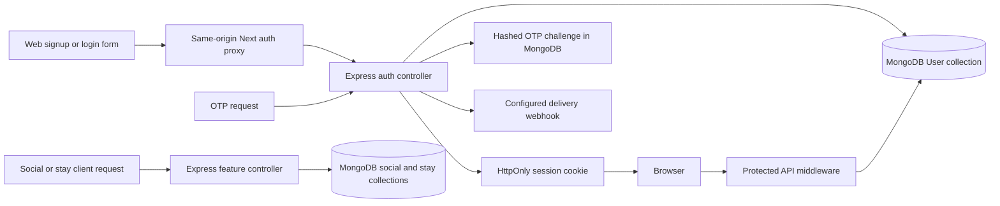

# User Data Audit and Local Database Migration Report

**Project:** Travel Buddy (C:\Users\aysha\Downloads\Travel-app.1)  
**Audit date:** 2026-11-02  
**Scope:** Baseline static code audit followed by implementation of the approved local MongoDB persistence and web authentication changes. Existing MongoDB records were not read, changed, or migrated.
**Line numbers:** The inventory and baseline findings in sections 1–12 use 1-based line numbers from the pre-implementation audit snapshot. See the implementation addendum at the end for the approved changes and current remaining work.

## 1. Executive summary

This is a multi-platform travel community application: Next.js/React web client, Express/TypeScript API, and early Android/iOS feed clients. The backend uses Mongoose and MongoDB. Its default URI points to local MongoDB, and .mongo_data contains WiredTiger runtime files, but this audit did not inspect binary records or establish that a running Mongo process uses that directory.

Baseline findings identified mixed memory/database authentication, memory-only OTP/admin challenges, browser-local tokens, mock social/stay handlers and missing relationship writes. The approved implementation now replaces the web/API account and admin flows with DB-backed operations, Mongo-persisted OTP challenges, cookie sessions, DB-backed social writes and stay reservations. See the implementation addendum for what is complete and what remains prototype-only.

**Migration conclusion:** Reuse MongoDB/Mongoose with a local MongoDB instance as the single source of truth. The code changes are in place, but no data migration was run. Back up and inventory the existing local database through MongoDB tools and classify existing records before any data cleanup/import.

Critical findings: source-code JWT fallback; source-code admin credential fallback (values redacted); OTP logging; hardcoded/fallback OTP and fake admin session paths in web UI; long-lived tokens in localStorage; password reveal/copy UI despite API masking; /me only searches memory; booking and like endpoints lack durable writes and user binding.

## 2. Audit method, completeness, exclusions

I inventoried repository files, searched source/configuration/tests/docs for user/auth/PII/location/booking/social/storage/token/database references, and read relevant models, routes, middleware, controllers, frontend/native clients, tests, configuration and manifests with line numbers. Existing remediation reports were treated as historical assertions, not proof of current behavior. This is static analysis: endpoints were not executed and tests were not run.

No text source file in the inventory below was inaccessible. This report audits code paths, not actual records in MongoDB.

Excluded:
- node_modules, Gradle/Xcode dependency caches and package internals: third-party code.
- .git internals.
- .mongo_data: WiredTiger files, journals, diagnostics and logs. Binary data/log contents not opened to avoid exposing PII. It may contain real data and must be preserved/backed up.
- Generated/build output such as .next, dist, build, coverage and compiled mobile outputs, if present.
- Remote media contents; source URL references were inspected.
- .env values and secret values; none are reproduced. .gitignore excludes environment files.

Potentially important excluded state: .mongo_data may contain actual user records. Inspect through an authorized read-only MongoDB export after backup; this report does not establish its contents.

## 3. Complete first-party file inventory examined

Paths are repository-relative. Generated/dependency directories and binary MongoDB runtime files are excluded as above.

.gitignore; README.md  
backend/package.json; backend/package-lock.json; backend/tsconfig.json  
backend/src/core/config/index.ts; backend/src/core/sockets/operationsHub.ts  
backend/src/features/admin-operations/adminOperations.controller.ts; backend/src/features/admin-operations/adminOperations.routes.ts  
backend/src/features/auth/auth.controller.ts; backend/src/features/auth/auth.routes.ts; backend/src/features/auth/user.model.ts  
backend/src/features/social/social.controller.ts; backend/src/features/social/social.model.ts; backend/src/features/social/social.routes.ts  
backend/src/features/stays/stay.model.ts; backend/src/features/stays/stays.controller.ts; backend/src/features/stays/stays.routes.ts  
backend/src/middlewares/auth.middleware.ts; backend/src/routes/api.routes.ts; backend/src/server.ts  
backend/test/auth.test.ts; backend/test/social.test.ts  
web/package.json; web/package-lock.json; web/next.config.mjs; web/next-env.d.ts; web/postcss.config.js; web/tailwind.config.js; web/tsconfig.json  
web/src/app/admin/error.tsx; web/src/app/admin/operations/layout.tsx; web/src/app/admin/operations/page.tsx; web/src/app/admin/operations/users/page.tsx; web/src/app/admin/page.tsx  
web/src/app/api/auth/[...slug]/route.ts; web/src/app/error.tsx; web/src/app/feed/page.tsx; web/src/app/global-error.tsx; web/src/app/globals.css; web/src/app/layout.tsx; web/src/app/not-found.tsx; web/src/app/page.tsx  
web/src/components/ContentContainer.tsx; web/src/components/Footer.tsx; web/src/components/Header.tsx; web/src/components/TravelLuggageBox.tsx  
web/src/features/admin/auth.ts; web/src/features/admin/types.ts; web/src/features/auth/userAuth.ts; web/src/features/social/types.ts  
web/src/lib/api.ts; web/src/lib/soundAlert.ts  
mobile-android/settings.gradle.kts; mobile-android/build.gradle.kts; mobile-android/app/build.gradle.kts; mobile-android/app/src/main/AndroidManifest.xml; mobile-android/app/src/main/res/values/strings.xml; mobile-android/app/src/main/java/com/travelapp/MainActivity.kt; mobile-android/app/src/main/java/com/travelapp/features/social/ui/TravelFeedScreen.kt  
mobile-ios/TravelApp/TravelApp.swift; mobile-ios/TravelApp/Features/Social/Views/TravelFeedView.swift  
scripts/verify-all.ps1  
docs/TICKETING_DECOMMISSIONING_AND_SECURITY_AUDIT_REPORT.md; docs/SENIOR_ENGINEER_SECURITY_IMPLEMENTATION_BLUEPRINT.md; docs/SENIOR_ENGINEERING_REMEDIATION_PLAN.md; docs/SECURITY_CHANGES_AND_REMEDIATION_ACTION_DOCUMENT.md; docs/SECURITY_AUDIT_AND_PENETRATION_TEST_REPORT.md; docs/REMEDIATION_COMPLETION_REPORT.md; docs/MASTER_SECURITY_REMEDIATION_ACTION_PLAN.md; docs/HACKER_DEV_REMEDIATION_GUIDE.md; docs/FINAL_SECURITY_REMEDIATION_REPORT.md; docs/CODE_AND_DATABASE_DUPLICATION_AUDIT_REPORT.md

Historical docs contain conflicting claims (e.g. file-vault and duplicate API assertions). Current listed source is authoritative. No file-backed user repository was found despite response text referring to “Persistent File DB.”

## 4. User-data inventory with exact locations

### Accounts, profiles, authentication

| File and lines | Structures and data fields | Purpose, source, flow, storage and status |
|---|---|---|
| backend/src/features/auth/user.model.ts:3-37,39-106 | UserRole, IUser/UserSchema/User: username, name, email, phone, passwordHash, role/status, avatarUrl, bio, agencyDetails (agency/license/IATA/verification), travelerPassport (number/country/expiry/nationality/DOB/gender), followers/following IDs/counts, verification flags, timestamps. | Canonical Mongoose User collection, supports USER/TRAVELER/TRAVEL_AGENCY/HOTEL_HOST/ADMIN/SUPER_ADMIN. Username unique; email/phone sparse unique. Passport/license fields are highly sensitive and not collected by signup UI. No profile-edit route found. DB-connected when controller calls succeed. |
| backend/src/features/auth/auth.controller.ts:22-67 | MemoryUser, DEFAULT_SEED_USERS, mutable memoryUsers; identity/contact/hash/role/status/avatar/bio/date. | Hardcoded demo accounts and process-local fallback. Not automatically inserted into Mongo. Seed values redacted. Memory disappears on restart; do not blindly import. |
| auth.controller.ts:80-176,181-243 | checkAvailability/checkStatus; username/email/phone/identifier, role/status. | Public request values checked against memory and optionally Mongo; read-only; exposes existence/status. Limited coercion/validation. |
| auth.controller.ts:365-521 | register: username/name/email/phone/password, OTP, bcrypt hash, forced USER role, avatar/bio, JWT. | Web form -> fetchFromApi -> Express. User.create only when Mongo ready; DB error is caught, then record appended to memory and success returned. Response claims storage and “Persistent File DB,” but no file store exists. Possible ephemeral real users. |
| auth.controller.ts:526-645,650-746,751-827 | login/reset: identifier/password/newPassword, OTP target/code, passwordHash/JWT. | Login searches DB then memory. Reset checks memory first and only conditionally updates DB. OTP in Map. Reset may succeed only in memory. |
| auth.controller.ts:832-908 | getProfile/getAllUsers; directory fields ID/name/contacts/role/status/avatar/bio/date plus masked password placeholder. | /me verifies token but searches memory only; DB-only users may 404. User directory queries DB when connected or memory otherwise. Hash not intentionally returned, but UI models password and has reveal controls. |
| auth.controller.ts:913-1000 | deleteUser/toggleBlockUser; target ID/username, actor/IP/time, status. | Admin writes DB when connected or mutates memory. No related-record cascade; memory changes ephemeral. |
| backend/src/features/admin-operations/adminOperations.controller.ts:21-84,89-133,138-195,201-245 | Credential verification; username/email/password/adminData, OTP, JWT identity/role. | Credentials from request, env or privileged User; source fallback admin credential exists (value redacted). OTP Map and plaintext logging. Optional DB auth. |
| backend/src/middlewares/auth.middleware.ts:6-16,21-63 | AuthenticatedUserPayload ID/username/role/email/name; bearer JWT verification and role guard. | Stateless signature/expiry verification; no live user/blocked check or session/revocation store. |
| backend/src/core/sockets/operationsHub.ts:11-47,58-67 | Socket token, decoded user in socket.data, admin room, alert data. | Token from handshake; SUPER_ADMIN required for room. In-memory socket context, no live account check/persistence. |
| web/src/app/page.tsx:36-85,154-217,224-402,409-536 | React login/signup/forgot states: username, name, email/phone, OTP, password and confirmation, identifier/target. | User enters forms; requests go to API; successful identity/token stored via userAuth. Confirm-password is UI-only. OTP previews can render if returned. No actual GPS, booking, review or upload form found. |
| web/src/features/auth/userAuth.ts:1-61 | UserSession ID/name/username/email/phone/role/avatar/bio/token/authenticatedAt and localStorage keys/events. | Browser-persisted session cache and token; not canonical account data; token readable by JavaScript. |
| web/src/features/admin/types.ts:1-14 | Admin credential/session interfaces. | Type declarations only. |
| web/src/features/admin/auth.ts:5-69 | Admin identity/token localStorage, legacy keys, logout call and storage clearing. | Browser-only; API logout does not revoke JWT. |
| web/src/app/admin/page.tsx:30-49,97-310,412-618 | Admin credentials, OTP, pending identity/token, OTP preview. | Sends challenge but includes client fallback OTP/token behavior; stores session in localStorage. Insecure for production. |
| web/src/app/admin/operations/layout.tsx:23-47,63-70 | Admin session and hardcoded master session. | Auto-provisions local admin profile/token when absent; not a server-verified grant. |
| web/src/app/admin/operations/users/page.tsx:36-63,69-88,91-178,182-212,562-704 | UserRecord: ID/name/username/email/phone/password?/role/status/avatar/bio; filters/search/copy/reveal state. | Loads directory to React state; block/delete API writes. Email/phone/password copy UI. Fetch at line 73 omits Authorization although backend requires bearer + SUPER_ADMIN; no injection found in that call. |
| web/src/app/admin/operations/page.tsx:82-120,178-200,259-266 | User counts and database/auth status labels. | Hardcoded dashboard claims are not evidence of actual DB state. |
| backend/test/auth.test.ts:26-215; backend/test/social.test.ts:56-90 | Test users, emails/passwords/OTP and roles. | Test fixtures/controller calls. Auth test can write durable records if run against a shared DB; isolate test database. Literal test credentials omitted. |

### Social content and interactions

| File and lines | Structures/data | Current flow/storage and migration |
|---|---|---|
| backend/src/features/social/social.model.ts:3-31,84-115 | IComment/IPost: owner IDs, userName/avatar, text/replies/likes, images/caption/locationName/city, likes/saves IDs and counts. | Intended Mongoose user content; no create/comment write route found. |
| social.model.ts:33-67,117-167 | IReel/IStory: owner, video/image URL, caption/audio/location, polls/votes, Q&A, viewers, expiry. | Model-only; no create/vote/respond routes or TTL index shown. URLs only; no upload service. |
| social.model.ts:69-82,169-188 | IDirectMessage: sender/recipient, text/audio URL/duration/waveform, stay share PNR/summary, read/time. | Model-only writes; only read API. Contains sensitive communication/travel data. |
| backend/src/features/social/social.controller.ts:7-162 | MOCK_POSTS/REELS/STORIES/DMS with sample names, media, locations, captions/comments/counts, polls/audio and sample stay reference. | Hardcoded demo arrays; not database records. |
| social.controller.ts:168-211,230-310,312-365 | Feed/reel/story/DM reads. | Try DB, but only return rows if nonempty; else return mocks. Empty DB appears populated. DM fallback is generic and not scoped to token user. |
| social.controller.ts:213-228; backend/src/features/social/social.routes.ts:6-10 | toggleLikePost postId and client isLiked. | Public; trusts client state and returns fabricated count; no persistence. |
| web/src/app/feed/page.tsx:6-88,92-160,162-250 | Static user/post/comment/location/media/count; local poll/like/audio state. | No API calls; React state resets on reload. Comment/share/bookmark controls are visual only. |
| web/src/features/social/types.ts:1-14 | SocialPost front-end type. | Type only. |
| mobile-android/app/src/main/java/com/travelapp/features/social/ui/TravelFeedScreen.kt:13-39 | Hardcoded identity/caption/landmark/likes. | Demo screen; no API/local DB. |
| mobile-ios/TravelApp/Features/Social/Views/TravelFeedView.swift:8-32 | Hardcoded identity/caption/likes. | Demo screen; no API/local DB. |

### Stays, bookings, locations, uploads, reviews

| File and lines | Structures/data | Current flow/storage and migration |
|---|---|---|
| backend/src/features/stays/stay.model.ts:3-25,77-104 | IHotel/Hotel: host User ID, name/city/address/rating/contact email/phone, business document URLs, verification/admin fields, amenities/images. | Intended Mongo model; controller does not query it. Sensitive verification/contact data. Stock URL defaults are not actual uploads. |
| stay.model.ts:27-55,106-135 | IRoom/Room: hotel ID, type/pricing/capacity/availability/photos/packages/amenities. | Schema only; controller uses static sample object. |
| stay.model.ts:57-75,137-168 | IRoomBooking/RoomBooking: orderId ref Booking, user/hotel/room IDs, dates/guests/package/requests/status/check-in/escrow/voucher. | Model only. Handler never uses it; no Booking model present although orderId references it. |
| backend/src/features/stays/stays.controller.ts:4-86,88-151 | MOCK_HOTELS; book inputs IDs; generated reference/voucher/price/commission/payout. | Static data. Decrements module room count and responds. No authenticated user, dates, party size, booking write, or actual DB inventory. |
| backend/src/features/stays/stays.routes.ts:6-7 | Public GET /hotels and POST /book. | No auth middleware; booking is not durable. |
| Web/native source inventory | GPS, location tracking, search history, preferences, reviews/ratings, real upload forms. | None found as active flows. Place-name text exists only in feed/model structures. |

Other user-related state:
- OTP Maps: auth.controller.ts:8-17,248-360,706-817; adminOperations.controller.ts:9-16,112-123,153-174. Lost on restart and not shared across API instances.
- User JWTs last 30 days: auth.controller.ts:494-499,620-625. Admin JWT lasts 24h: adminOperations.controller.ts:175-185,223-234. Stateless, not DB sessions.
- Admin mutation logs have actor/target/IP/time at auth.controller.ts:917-920,956-960; stdout only.
- No active search history, GPS coordinates, reviews, ratings, real uploads, guest accounts or preferences found.

## 5. Data-flow diagrams

Authentication:
Web form -> fetchFromApi -> Express auth -> Mongo User if connected, otherwise memoryUsers fallback -> JWT response -> browser localStorage -> /me -> memoryUsers only.

Social:
Web mock feed -> React state for likes/polls (no API write). API GET -> Mongoose if nonempty, else MOCK arrays. Like POST -> fabricated response, no DB write.

Stays:
POST /api/v1/stays/book -> StaysController -> static MOCK_HOTELS / process memory -> generated booking reference response -> no RoomBooking write. RoomBooking model exists but is unused.

## 6. Existing database architecture

- MongoDB/Mongoose: backend package includes mongoose; server.ts:80-87 connects; core/config/index.ts:12-18 sets MONGO_URI default. .mongo_data presence does not prove it is the active dbpath.
- Connection is asynchronous and the API listens regardless of failure; no readiness gate/retry.
- Models: User, Post, Reel, Story, DirectMessage, Hotel, Room, RoomBooking. No migration framework, SQL schema or explicit seed/migration script found.
- Relations use ObjectId refs among users/social/stay entities. RoomBooking orderId refers to missing Booking model. Followers and social engagement have both ID arrays and counters that may drift.
- Actual DB calls: user lookups/create/reset/block/delete/list; social reads; no stay model calls. No social create/comment/message or booking write endpoint.
- Role inconsistency: registration USER; seeds/types TRAVELER; admin ADMIN/SUPER_ADMIN; UI HOTEL while schema HOTEL_HOST.
- Sensitive passport/agency fields exist but no current UI collection flow. User listing fetches full docs before mapping fields; use projection.

**Reuse decision:** Reuse Mongo/Mongoose for local-host DB; a second SQL stack is not justified. Configure local instance explicitly, back up first, make DB readiness required for real writes.

## 7. Non-database data inventory

| Location | Type, why disconnected | Recommendation |
|---|---|---|
| auth.controller.ts:37-67 | Static seed/demo identities. | Do not import by default; keep isolated dev fixtures. |
| auth.controller.ts:462-487 | Real signup can enter process memory on DB failure. | If still alive, migrate only after confirming real; future writes must fail closed. Restart loses it. |
| auth.controller.ts:8-17,281-287,320-349,720-817 | Temporary OTP challenge Map. | Do not migrate plaintext codes; use hashed short-lived one-use challenges with TTL/attempt limits. |
| adminOperations.controller.ts:9-16,112-123 | Admin OTP Map and logs. | Replace with secure challenge storage; remove code logging. |
| social.controller.ts:7-162 | Static mock content. | Not real migration data; use isolated demo fixtures only. |
| web/src/app/feed/page.tsx:11-88,116-138 | Mock content and local poll/like state. | Not recoverable after reload; add authenticated writes only for approved feature scope. |
| web/src/app/admin/page.tsx:40-43,240-280,525-530 | OTP preview/fixed fallback token/code. | Never migrate; remove bypass. |
| web/src/app/admin/operations/layout.tsx:34-45,67-71 | Fake admin session. | Never migrate; require verified API session. |
| web/src/features/auth/userAuth.ts:14-44; web/src/features/admin/auth.ts:5-32,53-63 | Browser session/token cache. | Not canonical account record; do not import token as user; clear/revoke during auth replacement. |
| social.controller.ts:213-228; stays.controller.ts:97-149 | Response-only like/booking and process room count. | No durable history to migrate; generated refs are not verified bookings. |
| backend/test/*.ts | Test fixtures. | Keep out of production; isolate test DB. |
| .mongo_data | Unknown existing DB records. | Potentially real; backup and inspect separately using MongoDB export. |

No sessionStorage user records are written; logout clears sessionStorage. No actual upload/GPS/search/preferences workflow was found.

## 8. Security findings

Severity is from code review; no penetration testing was performed.

| Severity | Location | Finding |
|---|---|---|
| Critical | backend/src/core/config/index.ts:7-17; backend/src/server.ts:12-18 | Source-code development JWT secret fallback. Require configured high-entropy secret; rotate/invalidate tokens. Value redacted. |
| Critical | backend/src/features/admin-operations/adminOperations.controller.ts:33-46 | Source fallback admin credentials (values redacted). Remove master credential path. |
| Critical | web/src/app/admin/page.tsx:40-43,240-280,525-530; web/src/app/admin/operations/layout.tsx:34-45 | Fixed OTP preview/fallback and auto-created fake admin session enable client-side bypass paths. Remove and require server-verified auth. |
| High | adminOperations.controller.ts:112-129,175-185,223-234; auth.controller.ts:277-299,716-742 | OTP uses Math.random; admin/reset code logged; reset response includes full target at line 739. Use crypto RNG, rate/attempt limits, masked responses and no code logs. |
| High | web/src/features/auth/userAuth.ts:14-37; web/src/features/admin/auth.ts:5-32 | Long-lived bearer tokens in localStorage are XSS-readable. Prefer HttpOnly Secure SameSite cookies, CSRF protection, short-lived tokens/rotation. |
| High | auth.controller.ts:365-484,526-645,751-814 | Signup/reset may succeed with only ephemeral memory on DB failure. Fail closed and report success only after durable commit. |
| High | auth.controller.ts:832-865; auth.routes.ts:30-36 | /me only searches memory; DB-only users may 404. Query DB by verified auth identity. |
| High | social.routes.ts:6-10; social.controller.ts:213-228 | Like endpoint public, trusts body state, fabricates count and does not write. Require auth and derive actor from token. |
| High | stays.routes.ts:6-7; stays.controller.ts:97-149 | Public booking route, no user binding, static price/inventory and no persistence. Do not claim real confirmation. |
| High | social.controller.ts:312-361 | DM handler manually parses optional JWT; mock fallback returns shared sample messages to any valid token. Use auth middleware, participant scope and empty result on empty DB. |
| High | auth.controller.ts:871-908; web/src/app/admin/operations/users/page.tsx:36-42,562-704 | UI has password reveal/copy despite API returning mask. Remove property and controls; query safe projection. |
| High | users/page.tsx:69-88; auth.routes.ts:33-36 | User directory fetch omits Authorization; backend requires Bearer + SUPER_ADMIN. Likely 401/403 unless an unobserved layer injects credentials; none found in this request path. |
| Medium | auth.controller.ts:384-386,767-770 | Six-character password minimum; trimming changes submitted password. Validate policy and don't trim password bytes. |
| Medium | backend/src/server.ts:24-29,61-65 | Wildcard Socket.IO/Express CORS. Restrict origins. |
| Medium | backend/src/server.ts:80-87 | API serves after DB failure, allowing false-success ephemeral state. Require readiness for production writes. |
| Medium | auth.controller.ts:173-175,518-520,642-644 and similar controllers | Raw exception messages returned to clients. Use stable generic errors and safe server logging. |
| Medium | user.model.ts:22-29,82-96; stay.model.ts:11-20 | Passport, DOB, gender, licenses/documents supported without present UI need. Minimize, restrict, define retention/encryption. |
| Medium | auth.controller.ts:921-930,962-977 | Block/delete falls back to memory; dependents not handled. Require DB and define deletion/anonymization policy. |
| Medium | auth.controller.ts:494-499,620-625; middleware.ts:21-40 | 30-day user JWT with no revocation/live block check. Shorten and check active status for sensitive operations. |
| Low | stay.model.ts:57-75,137-164 | orderId references absent Booking model. Confirm before implementation. |
| Low | .gitignore:1-52 | Env files ignored, positive; deployment secrets and backup permissions cannot be verified. |

No SQL code found. No raw client object spread into Mongo filters was found, but schemas/validation are incomplete and query casting is inconsistent. No dedicated NoSQL sanitization middleware found. This is static review, not tested injection.

## 9. Recommended local database architecture

Use local MongoDB + Mongoose already present. Configure a dedicated application URI/database via backend environment variables; keep DB/JWT secrets out of source and NEXT_PUBLIC variables. Frontends/mobile call the API only. Take backup before changes and enforce DB readiness.

Collections/domains:
1. User: existing account fields; salted passwordHash only; safe profile DTOs. Restrict or split passport/agency verification data only if needed; current UI does not require it.
2. Post, Reel, Story, DirectMessage: existing shapes. Add authenticated writes only for approved features; validate ownership/privacy and maintain counters consistently. Define retention and indexes for owner/time, participant/time and story expiry.
3. Hotel, Room, RoomBooking: existing shapes. Resolve absent Booking ref. Bind reservation to authenticated User, validate date/party/package, server price and atomic inventory. Do not invent a payment/order model.
4. OTP challenges: short-lived hashed code, target/purpose/expiry/attempt/verified state based on existing OtpRecord concept; TTL index; no plaintext code.
5. Revocation/audit: only if immediate logout/block and durable admin audit are requirements. No current model exists; approve fields and retention before adding.

Illustrative existing User data shape, not an applied migration:
User: username, name, email?, phone?, passwordHash, role, status, avatarUrl?, bio?, agencyDetails?, travelerPassport?, followersCount, followingCount, followers[], following[], isVerified, createdAt, updatedAt.
Nested sensitive structures are defined at user.model.ts:82-96. Use projections and explicit DTO validation; do not activate optional sensitive collection without product approval.

## 10. API integration requirements

- Keep Express /api/v1 authoritative. Next proxy at web/src/app/api/auth/[...slug]/route.ts:9-16 forwards auth routes; ensure web helpers send auth credentials consistently.
- Validate signup/login/reset; normalize username/email/phone; rely on unique indexes; map duplicate errors safely. Only return success after commit.
- Make /me query the authenticated user from middleware; never accept arbitrary profile ID.
- Keep SUPER_ADMIN guard; remove password UI; project safe fields; audit block/delete.
- Add authenticated social write routes only for chosen features; derive actor from token; validate content/media and compute counts server-side.
- Hotel reads should query models. Booking needs authentication, dates/party, server price validation, atomic reservation/inventory and durable voucher. Do not trust client price/identity.
- No upload service exists. If added, validate size/type, store safely and protect document links.
- Redact secrets, OTPs, JWTs, PNRs, contacts and request bodies in logs; return stable errors; restrict CORS.

## 11. Migration plan (approval required before implementation)

### Preserve and classify
1. Confirm .mongo_data association with a running Mongo daemon and DB name using MongoDB tooling.
2. Take protected consistent backup/export; record date, counts, indexes and checksum. Preserve original.
3. Inventory User/posts/reels/stories/directmessages/hotels/rooms/roombookings and unexpected collections in a redacted working copy. Classify real versus seed/test by approved criteria.
4. Never treat source mocks, fake admin sessions, generated refs or tokens as canonical records.

### Make writes reliable
5. Configure explicit local URI/readiness; fail account/reset/booking writes on DB failure.
6. Add validated DTOs/safe projections, DB-backed /me, remove auth bypass and OTP logging.
7. Connect approved social/booking features to existing models; resolve RoomBooking.orderId/absent Booking.
8. Normalize roles and define counter consistency.

### Migrate
9. Build idempotent script and rehearse on a copied staging DB. Preserve IDs where safe, normalize identifiers, detect unique conflicts, map only documented roles.
10. Do not import source seed users. If real plaintext credentials are discovered, stop and design reset/rotation; never copy/report cleartext.
11. localStorage holds session cache/token, not canonical signup data. Do not import tokens; reauthenticate and invalidate old tokens.
12. Import social/stay rows only if confirmed in a durable source. Transient React state cannot be recovered after page close.
13. Verify counts, ObjectId relations, indexes, timestamps/time zones, roles/media/inventory; retain rollback snapshot.

### Cutover and retention
14. Deploy with DB readiness and secure session design; verify clients use API as source of truth.
15. Compare redacted samples/counts, monitor errors, retain rollback until accepted.
16. Define export/deletion/retention for accounts, passport data, messages, bookings, OTP and logs. Implement approved cascade/anonymization.

## 12. Testing and validation checklist

No tests were run for this static audit. Before migration/cutover verify:
- DB outage safely fails; no false-success memory account/reset/booking.
- Signup/login identifiers, duplicate normalization, bcrypt secrecy and role escalation.
- /me resolves DB-only users; blocked/deleted/expired/revoked sessions denied.
- OTP generation, purpose, expiry, one-use, attempt limits, multiprocess handling and no code/target leak.
- SUPER_ADMIN/ordinary/anonymous access; explicit UI credential forwarding.
- User listing excludes password/hash; block/delete durable and follows approved relation policy.
- Social ownership/privacy, idempotent likes, server counts, DM scoping, story expiry and production empty DB without mock fallback.
- Booking user/date/capacity/price validation, concurrent inventory, idempotency and commit before confirmation.
- Migration idempotence, rollback, duplicate handling, relation integrity and backup restore.
- Browser token/XSS protection, cookie flags/CSRF, logout revocation, CORS allowlist and no secrets in built client.

## 13. Final recommendations

1. Reuse local MongoDB/Mongoose; no second database is justified by source.
2. Treat .mongo_data as potentially real. Back up and inspect via read-only MongoDB export; its contents were not audited here.
3. Make MongoDB source of truth; remove ephemeral fallbacks and fix /me.
4. Remove admin bypasses, source JWT defaults, OTP logs and localStorage bearer tokens; rotate secrets and invalidate old tokens when secure replacement is ready.
5. Remove password reveal/copy UI and never expose hashes/password fields.
6. Treat social/reservation schemas as disconnected until authenticated durable write paths exist; demo interactions/references are not persisted records.
7. Approve any passport/business verification collection separately; current UI does not require it.
8. Use staged, backed-up, idempotent migration with verification and rollback. The approved code-side persistence changes are recorded in section 14; no existing database records were migrated.

**Approval boundary:** The user subsequently approved code implementation (“Proceed”). Any record-level migration or cleanup of the existing local MongoDB data still requires a backup and separate confirmation of the real data and intended treatment.

**Mobile location check:** mobile-android/app/src/main/AndroidManifest.xml:4-6 declares internet, network-state and vibration permissions; no location permission is present. Android/iOS screens are static feed demos and contain no local persistence or API client.

## 14. Approved implementation addendum (2026-11-02)

The user approved proceeding after review. The following source changes implement the code-side persistence plan. This does not mean existing database records were migrated: `.mongo_data` and MongoDB collections were left untouched, no application data was read/exported, and no migration script was run.

### Implemented

- **MongoDB readiness and secrets:** `backend/src/server.ts:102-119` now starts the API only after MongoDB connects; `backend/src/core/config/index.ts` removes the source JWT fallback and requires a configured production secret. Local MongoDB remains the default URI. `backend/.env.example` documents local settings.
- **Account persistence:** `backend/src/features/auth/auth.controller.ts:127-265` uses MongoDB for registration, login, password reset and current profile, returns failure when DB is unavailable, hashes passwords with bcrypt, enforces a 10-character minimum, and returns safe account fields. The existing User collection remains the account store; `passwordHash` is excluded by default in `backend/src/features/auth/user.model.ts:70`.
- **Challenges and sessions:** `backend/src/features/auth/authChallenge.model.ts:15-27` adds a Mongo `AuthChallenge` collection with unique target/purpose, hash-only OTP, expiry, attempt counter and TTL behavior. `backend/src/features/auth/otp.service.ts` generates cryptographic codes and dispatches them only through a configured server-side webhook; no code is returned to the UI or logged. `backend/src/features/auth/session.ts:3-18` sets HttpOnly, SameSite=Lax cookies, Secure in production. User middleware reloads the current DB user and checks blocked status.
- **Admin access:** `backend/src/features/admin-operations/adminOperations.controller.ts` removes code-level credentials and memory OTPs and checks an active `SUPER_ADMIN` record. `backend/src/scripts/bootstrap-admin.ts` and `backend/package.json` provide an explicit one-time environment-driven bootstrap command. `web/src/app/api/admin/[...slug]/route.ts` now proxies admin calls to Express. Admin session browser data is profile-only; cookie verification gates admin operations.
- **Social persistence:** `backend/src/features/social/social.controller.ts:40-116,253-279` provides DB-backed post, like, comment, save, reel, story, poll/answer and text-message operations, with authenticated writes and user-derived actor IDs. Mock API fallback data was removed. `web/src/app/feed/page.tsx` loads the API feed and submits post/like/save/comment actions. Empty DB now yields an empty feed.
- **Stays persistence:** `backend/src/features/stays/stays.controller.ts:26-95` reads verified hotels/rooms and creates authenticated bookings in MongoDB after server-side pricing and inventory checks. `:97-135` lists and cancels the caller's future bookings. `RoomBooking` now stores generated booking reference and calculated price/commission/payout fields in `backend/src/features/stays/stay.model.ts:164-167`; the old reference to the missing `Booking` model was removed. This is still a simple inventory counter, not a date-overlap reservation engine or payment integration.
- **Web client:** login/signup no longer store bearer tokens; localStorage retains only a profile cache which is checked against `/auth/me`. Admin password/OTP bypasses and user password display/copy controls were removed. Requests include credentials. Old localStorage token keys are deleted as part of the client migration.
- **Documentation:** README explains MongoDB startup, OTP webhook requirements and initial admin bootstrap.

### Remaining disconnected or not migrated

| Location/data | Current status | Next action |
|---|---|---|
| `mobile-android/app/src/main/java/com/travelapp/features/social/ui/TravelFeedScreen.kt` and `mobile-ios/TravelApp/Features/Social/Views/TravelFeedView.swift` | Hardcoded sample travel identities/posts remain demo UI. They are not real user records and are not sent to the API. Native clients still have no API/auth integration. | Connect native clients to the secured API as a separate client integration; do not import demo content. |
| `web/src/app/admin/operations/page.tsx` | Some dashboard summary figures/status labels remain presentation-only; user count now comes from the API. | Replace remaining estimates with real metrics or label as unavailable before treating as operational reporting. |
| `web/src/features/auth/userAuth.ts` and `web/src/features/admin/auth.ts` | Browser localStorage retains a non-secret profile cache for display, not credentials. Authentication authority is the HttpOnly cookie plus `/me` or `/admin/verify`. | Clear old token keys; caches can be deleted without data migration. Consider sessionStorage/memory if profile caching is unnecessary. |
| `backend/src/features/auth/authChallenge.model.ts` / OTP webhook | Challenge metadata is stored locally; delivery depends on `OTP_DELIVERY_WEBHOOK_URL` and `OTP_DELIVERY_WEBHOOK_TOKEN`, which have not been configured or exercised. | Configure a trusted delivery service, restrict webhook egress and verify delivery/expiry/rate limits operationally. |
| `.mongo_data` and any pre-existing Mongo collections | Unknown, uninspected, possibly real data. | Back up and perform a read-only inventory, then approve a record-level migration/cleanup separately. No records were changed. |
| `backend/test/*.ts` | Historical tests may assert removed in-memory/mock behavior. | Review/update tests and run the project's test/build checks before deployment. They were not run during this implementation turn. |
| Reels, stories, DMs, bookings | Backend endpoints now persist writes, but the web application has no complete UI for all these workflows; native clients remain prototypes. | Connect only the desired client workflows and validate privacy, media hosting, retention and booking/payment requirements. |

### Current data destinations

- `User` collection: account identifiers, profile, role/status, bcrypt hash, optional agency/passport fields (not newly collected by current signup UI).
- `AuthChallenge` collection: normalized target, purpose, HMAC code hash, expiry, attempt count and verification timestamp; TTL cleanup depends on MongoDB TTL index processing.
- Existing `Post`, `Reel`, `Story`, `DirectMessage`, `Hotel`, `Room`, `RoomBooking` collections: existing model data; new controller paths write the represented data. No collection was backfilled or normalized.
- Cookie: signed session token in an HttpOnly browser cookie; the token itself is not stored in MongoDB. MongoDB live user lookup makes block/delete effective on subsequent protected requests, while logout clears the browser cookie but does not maintain a server-side revocation list.
- No local persistence was added for GPS history, searches, preferences, reviews/ratings or uploaded file bytes; the audited application has no active collection flows for these. Media fields accept URLs only, so hosting and ownership validation remain separate work.

### Current implemented data flow

The browser profile cache is display state only; protected requests validate the signed cookie and reload the account from MongoDB. Social/stay API calls from the web helper may go directly to the configured backend URL; credentials are included and the backend CORS allowlist must match the web origin. Native clients remain outside this current flow.

### Current security re-assessment and limitations

The code-level JWT default, memory account fallback, source-coded admin fallback, OTP preview/logging, fake admin session, localStorage bearer-token writes, unsafe password listing, mock feed fallback and public unbound booking/like handlers identified in the baseline are removed or replaced in the changed paths. Production must still provide a strong `JWT_SECRET`, restrict `CORS_ORIGIN`, configure OTP delivery, and use HTTPS. The bootstrap admin password is supplied via environment for the one-time command and must not be committed.

No CSRF token scheme, durable session revocation store, data-retention policy, audit log collection, upload service, date-overlap booking lock, payment flow, native API integration or existing-record migration was added. Current express rate limits and OTP attempt caps are operational safeguards, not a substitute for monitoring/abuse review. The auth proxy's existing error path and older unrelated modules may still need a separate hardening pass.

Public `/auth/check-availability` and `/auth/check-status` still disclose identifier availability and account role/status information. Keep them rate-limited, return the minimum required information, and avoid exposing detailed account status to unauthenticated callers if the product flow does not require it. Admin directory access remains SUPER_ADMIN-only.

### Implementation validation status

No tests or build/typecheck commands were run. No live API calls, OTP delivery, admin bootstrap, database writes, exports, imports, backups or MongoDB maintenance commands were run. Review the changed code, configure a disposable local MongoDB and OTP test endpoint, then run build/tests and the checklist in section 12 before deployment. Sections 1–12 describe the baseline audit and migration plan; this addendum records what changed afterward.
