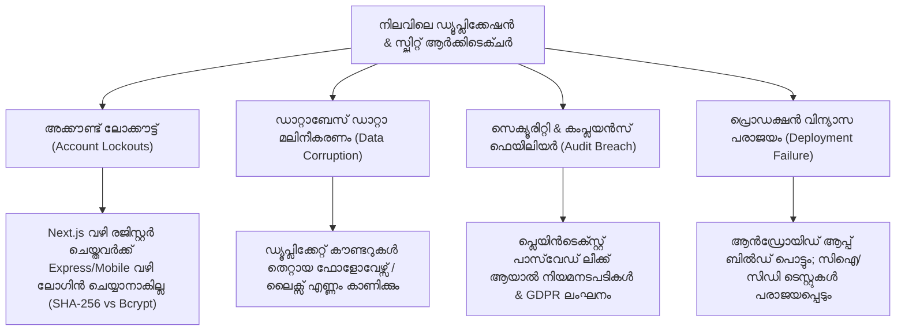
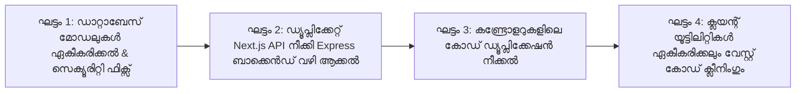

# 🏛️ സീനിയർ എൻജിനീയറിങ് ആർക്കിടെക്ചർ റിവ്യൂ & റെമഡിയേഷൻ പ്ലാൻ
**Senior Engineering Architecture Review, Risk Analysis & Remediation Blueprint**

> **റോൾ (Role):** Senior Principal Software Architect & Core Engineering Review Board  
> **ലക്ഷ്യം (Objective):** `Travel-app.1` കോഡ്ബേസിലെ ഡ്യൂപ്ലിക്കേഷനുകളും ആർക്കിടെക്ചറൽ തകരാറുകളും സുരക്ഷിതമായി പരിഹരിക്കാനുള്ള സമഗ്ര കർമ്മരേഖ (Step-by-step Execution Plan).  
> **സ്റ്റാറ്റസ് (Status):** റിവ്യൂ പൂർത്തിയായി, അംഗീകാരത്തിനായി സമർപ്പിക്കുന്നു (Ready for Review).

---

## 🧭 1. സീനിയർ ഡെവലപ്പർ ടീമിന്റെ ആർക്കിടെക്ചറൽ വിലയിരുത്തൽ (Executive Engineering Appraisal)

ഒരു സീനിയർ എഞ്ചിനീയറിംഗ് ടീം ഈ പ്രോജക്റ്റിനെ സമഗ്രമായി വിലയിരുത്തുമ്പോൾ കാണാൻ കഴിയുന്നത്, പ്രോജക്റ്റ് അതിവേഗത്തിൽ ഫീച്ചറുകൾ ആഡ് ചെയ്ത് വളർന്നപ്പോൾ ഉണ്ടായ **"ടെക്നിക്കൽ ഡെറ്റ്" (Technical Debt)**, **"സ്പ്ലിറ്റ്-ബ്രെയിൻ സിൻഡ്രോം" (Split-Brain Architecture)** എന്നിവയാണ്.

### ⚠️ നിലവിലെ പ്രധാന ആർക്കിടെക്ചർ പിഴവുകൾ:
1. **ഡ്യൂവൽ-ബാക്കെൻഡ് സ്പ്ലിറ്റ് (Dual Backend Split-Brain):**  
   Express സെർവറിലും Next.js ആപ്പിലും ഒരേസമയം ഒരേ ഡാറ്റാബേസ് ലോജിക് വെവ്വേറെ എഴുതിയിരിക്കുന്നു. ഇത് ഭാവിയിൽ വളരെ അപകടകരമാണ്.
2. **ഡാറ്റാബേസ് സുരക്ഷാ പൊരുത്തക്കേടുകൾ (Cryptographic & Security Inconsistencies):**  
   പ്ലെയിൻടെക്സ്റ്റ് പാസ്‌വേഡ് സൂക്ഷിക്കലും, രണ്ട് വ്യത്യസ്ത ഹാഷിങ് രീതികളും (Bcrypt vs SHA-256) ഉപയോഗിക്കുന്നത് സിസ്റ്റത്തെ നിമിഷങ്ങൾക്കകം തകരാറിലാക്കാം.
3. **ഡീനോർമലൈസേഷൻ പിഴവുകൾ (Denormalization Flaws):**  
   കൗണ്ടർ ഫീൽഡുകളും അറേ ഡാറ്റയും ഒരേസമയം സൂക്ഷിക്കുന്നത് കോൺകറന്റ് റിക്വസ്റ്റുകൾ വരുമ്പോൾ ഡാറ്റ തെറ്റാൻ കാരണമാകും.
4. **ബ്രോക്കൺ മൊബൈൽ & ടെസ്റ്റ് പൈപ്പ്‌ലൈൻ (Broken Mobile & CI Pipelines):**  
   ആൻഡ്രോയിഡ് ആപ്പിൽ ഇല്ലാത്ത ഡാറ്റാബേസ് ഫയലുകൾ ഇംപോർട്ട് ചെയ്തിരിക്കുന്നു; പഴയ കമ്പൈൽഡ് ഫയലുകൾ ബാക്കെൻഡ് ഡിസ്റ്റിൽ അവശേഷിക്കുന്നു.

---

## 🔮 2. ഭാവിയിൽ വരാൻ സാധ്യതയുള്ള ഭീഷണികളും പ്രശ്നങ്ങളും (Future Risks & Impact Analysis)

ഈ ഇഷ്യൂസ് കൃത്യമായി ഫിക്സ് ചെയ്തില്ലെങ്കിൽ ഭാവിയിൽ താഴെ പറയുന്ന ഗുരുതരമായ പ്രശ്നങ്ങൾ ഉണ്ടാകും:



### 1. ഉപയോക്താക്കൾ ബ്ലോക്കാകൽ (Silent Account Lockouts)
* **കാരണം:** Next.js റൂട്ട് SHA-256 ഹാഷ് ഡാറ്റാബേസിൽ ഇടുന്നു; Express ബാക്കെൻഡ് Bcrypt ഹാഷ് മാത്രം ചെക്ക് ചെയ്യുന്നു.
* **ഭവിഷ്യത്ത്:** വെബ്ബ് വഴി സൈൻ-അപ്പ് ചെയ്ത യൂസർക്ക് മൊബൈൽ ആപ്പ് വഴിയോ ബാക്കെൻഡ് എപിഐ വഴിയോ ലോഗിൻ ചെയ്യാൻ കഴിയില്ല.

### 2. കൗണ്ടർ ഡ്രിഫ്റ്റും ഡാറ്റാ പൊരുത്തക്കേടും (Counter Drift & Race Conditions)
* ഒരേ സമയം 100 പേർ ഒരു പോസ്റ്റ് ലൈക്ക് ചെയ്യുകയോ ഒരാളെ ഫോളോ ചെയ്യുകയോ ചെയ്യുമ്പോൾ `likesCount` മാറ്റിവെച്ച് അറേ മാത്രം അപ്‌ഡേറ്റായാൽ പ്രൊഫൈലിൽ കാണിക്കുന്ന സംഖ്യയും യഥാർത്ഥ ലിസ്റ്റും തമ്മിൽ വ്യത്യാസം വരും.

### 3. പ്രൊഡക്ഷൻ പോർട്ട് റൺ-ടൈം കൊളിഷൻ (Port Hunting Anti-Pattern)
* ക്ലയന്റ് കോഡിൽ `localhost:5000`, `localhost:5001`, `localhost:4550` എന്നീ പോർട്ടുകളിലേക്ക് തുടർച്ചയായി ലൂപ്പ് അടിച്ച് ഫെച്ച് ചെയ്യുന്നത് പ്രൊഡക്ഷൻ ക്ലൗഡ് / ഡോക്കർ (Docker) എൻവയോൺമെന്റിൽ സൈറ്റ് മൊത്തമായി സ്ലോ ആക്കും.

### 4. മൊബൈൽ ആപ്പ് കംപൈലേഷൻ തടസ്സം (Mobile Compilation Blocker)
* `OfflineVaultTicket`, `OfflineVaultDao` എന്നിവ ഇല്ലാത്തതിനാൽ ആൻഡ്രോയിഡ് ആപ്പ് ഏതെങ്കിലും സിഐ/സിഡി ടൂൾ വഴി ബിൽഡ് ചെയ്യുമ്പോൾ തന്നെ ഫെയിലിയർ അടിക്കും.

---

## 🛡️ 3. ഫിക്സ് ചെയ്യുമ്പോൾ ശ്രദ്ധിക്കേണ്ട അതീവ ജാഗ്രതാ നിർദ്ദേശങ്ങൾ (Critical Precautions)

ഒരു സീനിയർ എഞ്ചിനീയറിംഗ് ടീം കോഡ് തിരുത്തുന്നതിന് മുമ്പ് താഴെ പറയുന്ന മുൻകരുതലുകൾ കർശനമായി പാലിക്കണം:

> [!CAUTION]
> **1. ക്ലൈന്റ് ബ്രേക്കിംഗ് ഒഴിവാക്കുക (No Breaking Changes to Client UI):**  
> `web/src/app/page.tsx`, `web/src/app/admin/...` എന്നീ പേജുകളിൽ നിലവിൽ എഴുതിയിരിക്കുന്ന ഫോമുകളുടെയും സ്റ്റേറ്റുകളുടെയും പ്രവർത്തനം തെറ്റാതെ തന്നെ ബാക്കെൻഡ് ലെയർ ഏകീകരിക്കണം.
>
> **2. നിലവിലുള്ള യൂസർ ഡാറ്റ സംരക്ഷിക്കുക (Data Loss Prevention):**  
> ഡാറ്റാബേസിൽ ഇപ്പോൾ സേവ് ചെയ്തിട്ടുള്ള യൂസർമാരെ ബാധിക്കാത്ത രീതിയിലായിരിക്കണം മോഡൽ മാറ്റങ്ങൾ.
>
> **3. പാസ്‌വേഡ് മൈഗ്രേഷൻ സ്ട്രാറ്റജി (Zero-Disruption Password Strategy):**  
> പ്ലെയിൻടെക്സ്റ്റ് പാസ്‌വേഡ് ഒഴിവാക്കുമ്പോൾ, മുൻപ് സേവ് ചെയ്ത യൂസർമാർക്ക് ലോഗിൻ ചെയ്യാൻ തടസ്സമുണ്ടാകരുത്.
>
> **4. സ്റ്റെപ്പ്-ബൈ-സ്റ്റെപ്പ് വെരിഫിക്കേഷൻ (Incremental Verification):**  
> ഒരൊറ്റയടിക്ക് എല്ലാം മാറ്റാതെ, ഓരോ ഘട്ടവും പൂർത്തിയാക്കി ടെസ്റ്റുകൾ റൺ ചെയ്ത് ഉറപ്പുവരുത്തിയ ശേഷം മാത്രം അടുത്ത ഘട്ടത്തിലേക്ക് കടക്കുക.

---

## 🎯 4. ഘട്ടം ഘട്ടമായുള്ള പരിഹാര കർമ്മരേഖ (Step-by-Step Remediation Roadmap)

നാല് പ്രധാന ഘട്ടങ്ങളായാണ് (Phases) ഈ റീഫാക്ടറിംഗ് നടപ്പിലാക്കേണ്ടത്:



---

### 🔹 ഘട്ടം 1: ഡാറ്റാബേസ് മോഡലുകൾ ഏകീകരിക്കലും സെക്യൂരിറ്റി സുരക്ഷിതമാക്കലും (P0 - Immediate)

#### 1.1 `UserSchema` പാസ്‌വേഡ് ഫീൽഡ് ക്ലീൻ ചെയ്യൽ
* **ഫയൽ:** [`backend/src/features/auth/user.model.ts`](file:///c:/Users/aysha/Downloads/Travel-app.1/backend/src/features/auth/user.model.ts)
* **നടപടി:**
  1. `password: { type: String }` എന്ന പ്ലെയിൻടെക്സ്റ്റ് ഫീൽഡ് സ്കീമയിൽ നിന്നും ഇന്റർഫേസിൽ നിന്നും പൂർണ്ണമായി നീക്കം ചെയ്യുക.
  2. `passwordHash: { type: String, required: true }` മാത്രം നിലനിർത്തുക.
  3. Mongoose pre-save hook അല്ലെങ്കിൽ കണ്ട്രോളർ വഴി എല്ലാ പാസ്‌വേഡുകളും നിർബന്ധമായും `bcrypt.hash(password, 10)` വഴി മാത്രം ഹാഷ് ചെയ്യുക.

#### 1.2 കൗണ്ടറുകൾ വെർച്വൽ പ്രോപ്പർട്ടികളാക്കുക (Virtuals & Normalization)
* **ഫയലുകൾ:** `user.model.ts`, `social.model.ts`
* **നടപടി:**
  1. `followersCount`, `followingCount`, `likesCount`, `commentsCount` എന്നിവ സ്റ്റാറ്റിക് നമ്പറുകളായി സൂക്ഷിക്കുന്നതിന് പകരം വെർച്വൽ ഗെറ്ററുകളാക്കുക:
     ```typescript
     UserSchema.virtual('followersCount').get(function() {
       return this.followers ? this.followers.length : 0;
     });
     PostSchema.virtual('likesCount').get(function() {
       return this.likes ? this.likes.length : 0;
     });
     ```
  2. ഇതോടെ കൗണ്ടർ സിങ്ക് തെറ്റുന്ന പ്രശ്നം ശാശ്വതമായി ഇല്ലാതാകും.

#### 1.3 കമന്റുകളിലെ യൂസർ ഡാറ്റ നോർമലൈസ് ചെയ്യൽ
* **ഫയൽ:** [`backend/src/features/social/social.model.ts`](file:///c:/Users/aysha/Downloads/Travel-app.1/backend/src/features/social/social.model.ts)
* **നടപടി:**
  - `comments`-ൽ `userName`, `userAvatar` ഹാർഡ്കോഡ് ചെയ്യുന്നത് മാറ്റി, `userId` റഫറൻസ് മാത്രം സൂക്ഷിക്കുക.
  - ക്വറി ചെയ്യുമ്പോൾ `.populate('comments.userId', 'name username avatarUrl')` വഴി ലൈവ് വിവരങ്ങൾ ലഭ്യമാക്കുക.

#### 1.4 എസ്ക്രോ സ്റ്റാറ്റസ് (Escrow Status) ഏകീകരിക്കൽ
* **ഫയലുകൾ:** `stay.model.ts`, `booking.model.ts`
* **നടപടി:**
  - രണ്ട് മോഡലുകളിലെയും `escrowStatus` എന്യൂമുകൾ ഒരൊറ്റ കോമൺ ടൈപ്പിലേക്ക് മാറ്റുക:  
    `'HELD_IN_ESCROW' | 'RELEASED_TO_HOST' | 'REFUNDED'`

---

### 🔹 ഘട്ടം 2: ഡ്യൂപ്ലിക്കേറ്റ് Next.js API ഒഴിവാക്കി ഒരൊറ്റ ബാക്കെൻഡ് ആക്കൽ (P0 - Immediate)

#### 2.1 Next.js റീറൈറ്റ്സ് (Rewrites) വഴി എപിഐ പ്രോക്സി സെറ്റ് ചെയ്യൽ
* **ഫയൽ:** [`web/next.config.mjs`](file:///c:/Users/aysha/Downloads/Travel-app.1/web/next.config.mjs)
* **നടപടി:** Next.js ആപ്പിലേക്ക് വരുന്ന `/api/:path*` കോളുകളെല്ലാം തനിയെ Express ബാക്കെൻഡിലേക്ക് (`http://localhost:5000/api/v1/:path*`) ഫോർവേഡ് ചെയ്യാൻ `rewrites` കോൺഫിഗർ ചെയ്യുക:
  ```javascript
  /** @type {import('next').NextConfig} */
  const nextConfig = {
    reactStrictMode: true,
    async rewrites() {
      const backendUrl = process.env.NEXT_PUBLIC_BACKEND_URL || 'http://localhost:5000';
      return [
        {
          source: '/api/:path*',
          destination: `${backendUrl}/api/v1/:path*`,
        },
      ];
    },
  };
  export default nextConfig;
  ```

#### 2.2 ഡ്യൂപ്ലിക്കേറ്റ് റൂട്ട് ഫയൽ നീക്കം ചെയ്യൽ / തിരുത്തൽ
* **ഫയൽ:** [`web/src/app/api/auth/[...slug]/route.ts`](file:///c:/Users/aysha/Downloads/Travel-app.1/web/src/app/api/auth/[...slug]/route.ts)
* **നടപടി:** 
  - 700+ വരികളുള്ള ഈ ഫയലിലെ ഡ്യൂപ്ലിക്കേറ്റ് മോംഗോഡ്രൈവർ, SHA-256 പാസ്‌വേഡ് ഹാഷിങ്, ഇൻ-മെമ്മറി യൂസർ ലിസ്റ്റ് എന്നിവ പൂർണ്ണമായി നീക്കം ചെയ്യുക.
  - മുകളിൽ പറഞ്ഞ Next.js Rewrite നിലവിൽ വരുന്നതോടെ ക്ലയന്റ് കോഡുകളിൽ ഒരു മാറ്റവും വരുത്താതെ തന്നെ എല്ലാ കോളുകളും കൃത്യമായി മെയിൻ Express ബാക്കെൻഡിലേക്ക് എത്തും.
  - ഇതോടെ **സ്പ്ലിറ്റ്-ബ്രെയിൻ അവസ്ഥയും OTP വെരിഫിക്കേഷൻ പരാജയങ്ങളും 100% ഇല്ലാതാകും**.

---

### 🔹 ഘട്ടം 3: കണ്ട്രോളറുകളിലെ കോഡ് ആവർത്തനം ഇല്ലാതാക്കൽ (P1 - High)

#### 3.1 അഡ്മിൻ ഓതന്റിക്കേഷൻ കോഡ് ഏകീകരിക്കൽ
* **ഫയൽ:** [`backend/src/features/admin-operations/adminOperations.controller.ts`](file:///c:/Users/aysha/Downloads/Travel-app.1/backend/src/features/admin-operations/adminOperations.controller.ts)
* **നടപടി:**
  - `validateAdminCredentials`, `loginAdmin` എന്നിവയിലെ ആവർത്തിച്ചുള്ള 60 വരികൾ മാറ്റി ഒരു റീയൂസബിൾ ഹെൽപ്പർ ഉണ്ടാക്കുക:
    ```typescript
    private static async verifyAdminIdentity(username: string, email: string, pass: string): Promise<{ valid: boolean; admin?: any }> {
      // ഒറ്റ സ്ഥലത്ത് മാത്രം പരിശോധന
    }
    ```
  - രണ്ട് ഫങ്ക്ഷനുകളിൽ നിന്നും ഈ ഹെൽപ്പർ മാത്രം കോൾ ചെയ്യുക.

---

### 🔹 ഘട്ടം 4: ക്ലയന്റ്-സൈഡ് യൂട്ടിലിറ്റികൾ ഏകീകരിക്കൽ (P1 - High)

#### 4.1 വെബ് ഓഡിയോ സിന്തസൈസർ കോമൺ ആക്കൽ
* **പുതിയ ഫയൽ:** `web/src/lib/soundAlert.ts`
* **നടപടി:**
  - `ticketing-desk/page.tsx`, `users/page.tsx` എന്നിവയിലെ കോപ്പി-പേസ്റ്റ് ചെയ്ത Web Audio കോഡ് മാറ്റി `soundAlert.ts`-ലേക്ക് മാറ്റുക.
  - രണ്ട് പേജുകളിലും `playChime('success')` എന്ന് മാത്രം കോൾ ചെയ്യുക.

#### 4.2 അഡ്മിൻ സെഷൻ സ്റ്റോറേജ് ഹെൽപ്പർ ഏകീകരിക്കലും ലെഗസി കീ ക്ലീനിംഗും
* **ഫയലുകൾ:** [`web/src/features/admin/auth.ts`](file:///c:/Users/aysha/Downloads/Travel-app.1/web/src/features/admin/auth.ts), [`web/src/app/admin/page.tsx`](file:///c:/Users/aysha/Downloads/Travel-app.1/web/src/app/admin/page.tsx)
* **നടപടി:**
  - `admin/page.tsx`-ൽ നേരിട്ട് `localStorage.setItem` അടിക്കുന്നത് ഒഴിവാക്കി `setAdminSession(adminData)` എന്ന ഫങ്ക്ഷൻ ഇംപോർട്ട് ചെയ്ത് ഉപയോഗിക്കുക.
  - ലെഗസി `ente_yathra_*` കീകൾ റീഡ്/റൈറ്റ് ചെയ്യുന്നത് അവസാനിപ്പിച്ച് പ്രോജക്റ്റിന്റെ ഔദ്യോഗിക `travel_buddy_*` കീകൾ മാത്രം ഉപയോഗിക്കുക.

#### 4.3 ടൈപ്പുകളുടെ ഡ്യൂപ്ലിക്കേഷൻ നീക്കൽ
* **ഫയലുകൾ:** `web/src/features/admin/auth.ts`, `web/src/features/admin/types.ts`
* **നടപടി:** `AdminUserSession` ഇന്റർഫേസ് `types.ts`-ൽ മാത്രം നിലനിർത്തുക, `auth.ts`-ൽ അവിടെനിന്ന് ഇംപോർട്ട് ചെയ്യുക.

#### 4.4 പോർട്ട് ഹണ്ടിംഗ് ലൂപ്പ് ഒഴിവാക്കൽ
* **ഫയൽ:** [`web/src/lib/api.ts`](file:///c:/Users/aysha/Downloads/Travel-app.1/web/src/lib/api.ts)
* **നടപടി:**
  - `['/api', 'http://localhost:5000/api/v1', 'http://localhost:5001/api/v1']` എന്ന ഹാർഡ്കോഡഡ് ലൂപ്പ് മാറ്റി, environment variable അല്ലെങ്കിൽ `/api` റീറൈറ്റ് എൻഡ്പോയിന്റ് മാത്രം സ്റ്റാൻഡേർഡൈസ് ചെയ്യുക.

---

### 🔹 ഘട്ടം 5: വേസ്റ്റ് കോഡുകൾ, ബ്രോക്കൺ ആൻഡ്രോയിഡ് DB, പരാജയപ്പെടുന്ന ടെസ്റ്റുകൾ ക്ലീൻ ചെയ്യൽ (P2 - Medium)

#### 5.1 പഴയ കമ്പൈൽഡ് ബാക്കെൻഡ് ഫയലുകൾ ക്ലീൻ ചെയ്യൽ
* **നടപടി:**
  - `backend/dist` ഫോൾഡർ പൂർണ്ണമായി ഡിലീറ്റ് ചെയ്യുക.
  - `npm run build --prefix backend` റൺ ചെയ്ത് ഇപ്പോഴുള്ള സോഴ്സ് ഫയലുകളിൽ നിന്ന് മാത്രം ഫ്രഷ് ബിൽഡ് ഉണ്ടാക്കുക (ഇതോടെ പഴയ `flights/`, `trains/` ഫയലുകൾ താനേ ഇല്ലാതാകും).

#### 5.2 പരാജയപ്പെടുന്ന `backend/test/ticketing.test.ts` ഫിക്സ് ചെയ്യൽ
* **നടപടി:**
  - ഈ ടെസ്റ്റ് ഫയലിൽ നിലവിലില്ലാത്ത സർവീസുകൾ ഇംപോർട്ട് ചെയ്യുന്നത് പരിഹരിക്കുക. പ്രോജക്റ്റിൽ ഇപ്പോൾ ഉപയോഗിക്കുന്ന ആക്റ്റീവ് സർവീസുകൾ മാത്രം ടെസ്റ്റ് ചെയ്യുക.

#### 5.3 ആൻഡ്രോയിഡ് ആപ്പ് `AppDatabase.kt` റിക്കവർ ചെയ്യൽ
* **ഫയൽ:** [`mobile-android/app/.../AppDatabase.kt`](file:///c:/Users/aysha/Downloads/Travel-app.1/mobile-android/app/src/main/java/com/travelapp/core/database/AppDatabase.kt)
* **നടപടി:**
  - നഷ്ടപ്പെട്ട `OfflineVaultTicket.kt` എൻറ്റിറ്റിയും `OfflineVaultDao.kt` ഇന്റർഫേസും പുനർനിർമ്മിക്കുക, അല്ലെങ്കിൽ ആപ്പ് ബിൽഡ് തടസ്സപ്പെടാത്ത രീതിയിൽ ഡാറ്റാബേസ് കോൺഫിഗറേഷൻ സ്റ്റെബിലൈസ് ചെയ്യുക.

#### 5.4 ഒഴിഞ്ഞ ഫോൾഡറുകൾ പരിപാലിക്കൽ
* `docs/`, `scripts/`, `backend/src/middlewares/`, `mobile-ios/TravelApp/Core/` എന്നിവയിൽ ആവശ്യമായ ഡോക്യുമെന്റേഷൻ / സ്ക്രിപ്റ്റുകൾ ചേർക്കുകയോ അല്ലെങ്കിൽ `.gitkeep` ഫയലുകൾ ചേർത്ത് പ്രോജക്റ്റ് ഓർഗനൈസ് ചെയ്യുകയോ ചെയ്യുക.

---

## 📋 5. റീഫാക്ടറിംഗ് ചെക്ക്‌ലിസ്റ്റ് & വെരിഫിക്കേഷൻ പ്ലാൻ (Verification & Acceptance Criteria)

ഫിക്സിങ് പൂർത്തിയായ ശേഷം പരിശോധിക്കേണ്ട അളവുകോലുകൾ:

| വെരിഫിക്കേഷൻ സ്റ്റെപ്പ് | പ്രതീക്ഷിക്കുന്ന ഫലം | സ്ഥിരീകരണ രീതി |
| :--- | :--- | :--- |
| **1. യൂസർ രജിസ്ട്രേഷൻ & ലോഗിൻ** | വെബ്ബ് വഴി രജിസ്റ്റർ ചെയ്ത് കൃത്യമായി ലോഗിൻ ആകണം | വെബ്ബ് പേജിൽ ടെസ്റ്റ് യൂസറെ ഉണ്ടാക്കി ലോഗിൻ ചെയ്യുക |
| **2. OTP വെരിഫിക്കേഷൻ** | ഒരൊറ്റ സെൻട്രൽ സ്റ്റോർ വഴി OTP ലഭിക്കുകയും വേരിഫൈ ആകുകയും വേണം | രജിസ്ട്രേഷൻ & Forgot password ഫ്ലോ ടെസ്റ്റ് ചെയ്യുക |
| **3. ബാക്കെൻഡ് ടെസ്റ്റ് സ്യൂട്ട്** | `npm test --prefix backend` 100% വിജയിക്കണം | `npm test --prefix backend` കമാൻഡ് റൺ ചെയ്യുക |
| **4. നെക്സ്റ്റ്.ജെഎസ് ബിൽഡ്** | `npm run build --prefix web` യാതൊരു എററുമില്ലാതെ പൂർത്തിയാകണം | വെബ് ബിൽഡ് റൺ ചെയ്യുക |
| **5. ഡാറ്റാബേസ് ക്ലീൻലിനെസ്സ്** | പ്ലെയിൻടെക്സ്റ്റ് പാസ്‌വേഡുകൾ ഡാറ്റാബേസിൽ ഉണ്ടാവരുത് | മോംഗോഡിബി യൂസർ ഡോക്യുമെന്റ് പരിശോധിക്കുക |

---

## 🚀 അടുത്തതായി ചെയ്യേണ്ടത് (Next Step)

ഈ ആർക്കിടെക്ചറൽ പ്ലാൻ താങ്കൾ പരിശോധിച്ച ശേഷം, ഇതിലെ ഘട്ടങ്ങൾ ഓരോന്നായി പ്രൊജക്റ്റിൽ നടപ്പിലാക്കാൻ അനുമതി നൽകിയാൽ (Proceed ചെയ്താൽ), **ഘട്ടം 1 (ഡാറ്റാബേസ് സെക്യൂരിറ്റി & മോഡലുകൾ)** മുതൽ കോഡിംഗ് ആരംഭിക്കാവുന്നതാണ്.
